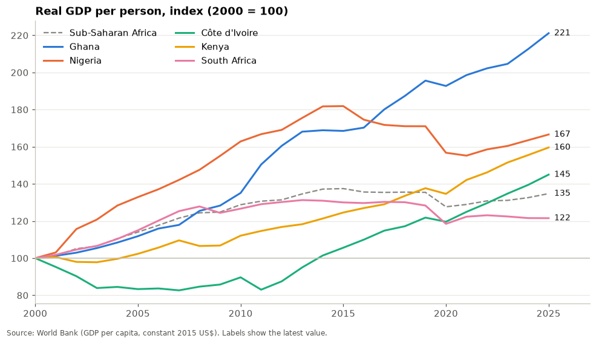
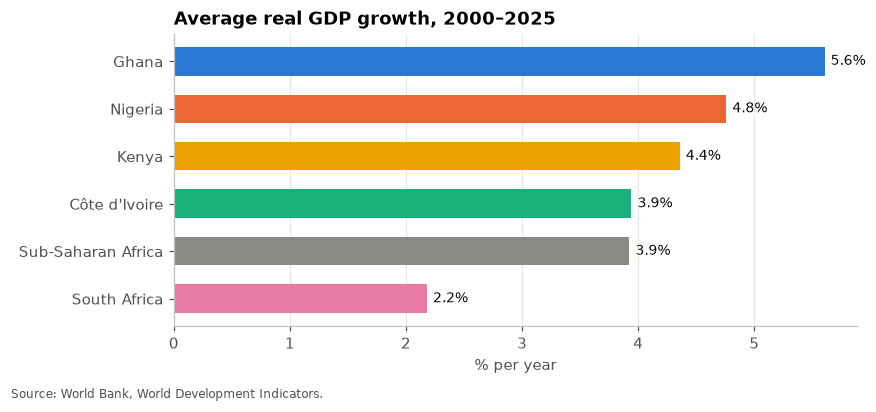
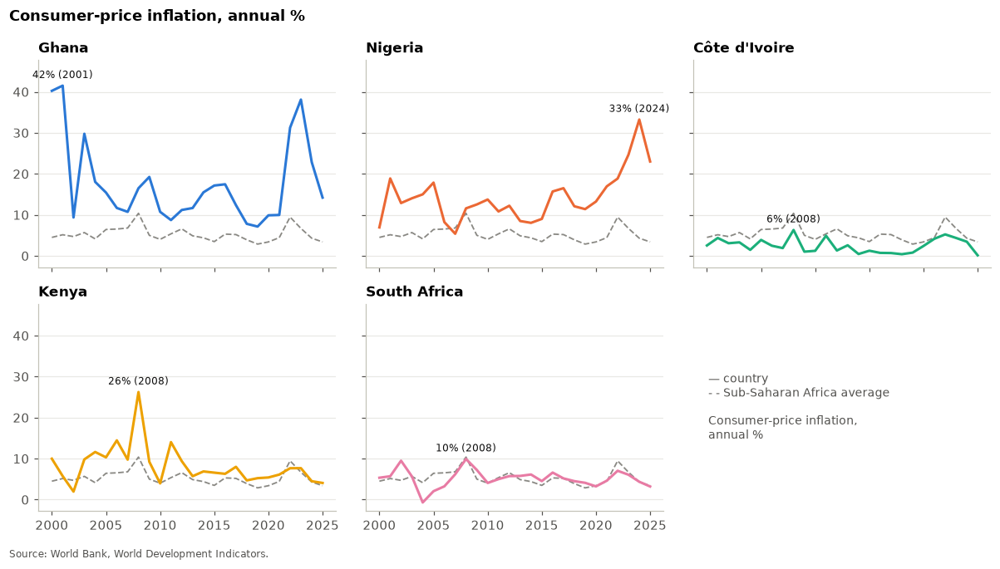
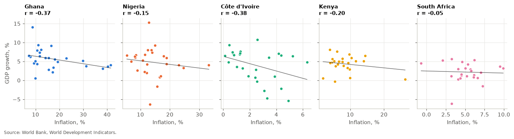
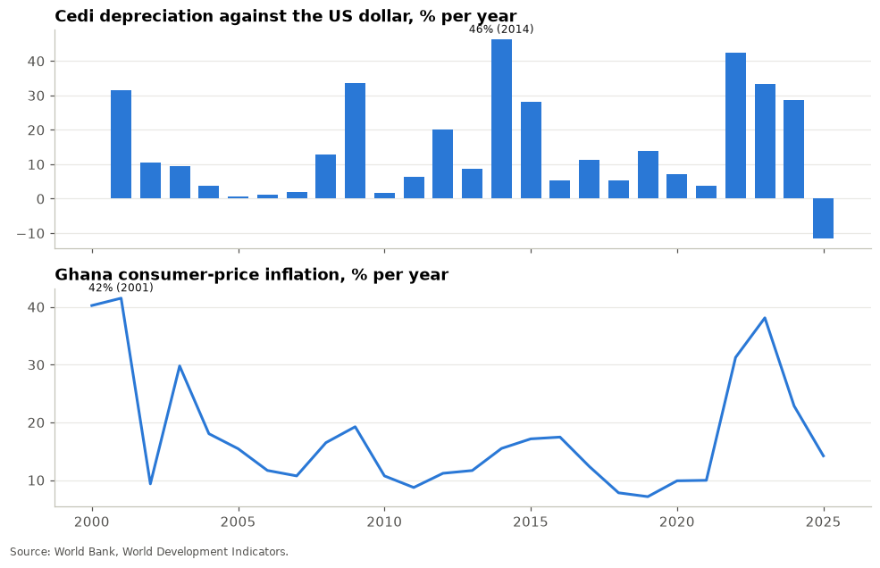

# Growth, Inflation and Living Standards in Five African Economies

An economic analysis of **Ghana, Nigeria, Côte d'Ivoire, Kenya and South Africa** from 2000 to 2025, compared with the Sub-Saharan Africa average, using open data from the **World Bank**.


> [!CAUTION]
> **For class teaching purposes only.** This project was prepared to teach data analysis with Python and open economic data. It is **not** a research paper, policy analysis or official statistical report. The country selection and time period are teaching choices (see [Scope and selection](#scope-and-selection)), the results are descriptive, and World Bank figures are revised over time. **Readers should be cautious about using these results in reports, publications or decisions.** Always check figures against the latest official sources and apply your own methods.

**👉 [Open the notebook](notebooks/africa_economic_trends.ipynb)** to see the full analysis. GitHub displays it directly, with no install needed.

## Scope and selection

This analysis covers five countries over 2000–2025. These are **teaching choices made to show clear contrasts**, not a representative sample of Sub-Saharan Africa.

**Why these countries**

| Country | Role in the comparison |
|---|---|
| **Ghana** | Focus country and the subject of the deep dive on currency and inflation |
| **Nigeria** | Large West African neighbour, oil exporter, floating currency |
| **Côte d'Ivoire** | West African neighbour using the CFA franc, which is pegged to the euro. It provides a contrast with Ghana's floating cedi |
| **Kenya** | East African comparison with a diversified, non-oil economy |
| **South Africa** | The region's most industrialised and highest-income economy in this group |
| **Sub-Saharan Africa** | Regional average, used as a benchmark |

Five countries also keep the charts readable for teaching.

**Why 2000–2025**

- **2025** is the latest complete year available from the World Bank at the time of download (November 2026).
- **2000** gives a 25-year window that includes the 2000s commodity boom, the 2008–09 global financial crisis, the 2014–16 oil-price fall, COVID-19 in 2020, and Ghana's 2022–23 debt and inflation crisis.

**What this means for the results**

- Findings describe **these five economies only** and should not be generalised to the whole region.
- Ghana was chosen as the focus country **before** the analysis. Its strong performance is a result, not a reason for selecting it.
- **Results depend on the start year.** Indexed growth (2000 = 100) and inflation peaks would differ with another start year. For example, Côte d'Ivoire looks weaker partly because 2000 came just before its crisis years, and Ghana's inflation was unusually high in 2000–01.
- To test this, change `COUNTRIES` or `START` in the notebook's setup cell, set `REFRESH = True`, and re-run.

## Questions

1. Whose living standards (real GDP per person) rose the most since 2000?
2. Which economies grew fastest, and which most steadily?
3. How have inflation episodes differed across countries?
4. Do years of high inflation tend to be years of slower growth?
5. **Ghana deep dive:** how closely does inflation follow the cedi's depreciation?

## Key findings

**1. Ghana more than doubled its real GDP per person (+121% since 2000)**, the strongest gain in the group. South Africa is still the richest economy here per person but grew the least (+22%). Côte d'Ivoire fell during the 2000s and has had the strongest recovery since 2011.



**2. Ghana also grew fastest on average (5.6% a year) and relatively steadily.** Kenya was similarly stable, while Côte d'Ivoire and South Africa had the most volatility for each point of growth.



**3. Inflation splits the group in two.** Ghana and Nigeria had inflation above 10% in 20 of the 26 years, while Côte d'Ivoire, whose CFA franc is pegged to the euro, never did. In 2025 Nigeria was still at 23%, while Ghana had eased to 14%.



**4. Higher-inflation years tend to be slower-growth years in all five countries**, but the link is weak to moderate (correlation −0.05 to −0.38).



**5. In Ghana, inflation moves with the cedi.** Depreciation and inflation are correlated at +0.57 in the same year. The largest depreciations, in 2014 and 2022, came with inflation surges.



> These are descriptive patterns for teaching, not estimates of cause and effect. See [Scope and selection](#scope-and-selection) above and the **Limitations** section at the end of the notebook before reusing any result.

## Data

All data comes from the [World Bank World Development Indicators](https://data.worldbank.org/), through the public [Indicators API](https://datahelpdesk.worldbank.org/knowledgebase/articles/889392), which needs no API key.

| Indicator | World Bank code |
|---|---|
| GDP growth (annual %) | `NY.GDP.MKTP.KD.ZG` |
| Inflation, consumer prices (annual %) | `FP.CPI.TOTL.ZG` |
| GDP per capita (constant 2015 US$) | `NY.GDP.PCAP.KD` |
| Unemployment (% of labour force, ILO modelled) | `SL.UEM.TOTL.ZS` |
| Official exchange rate (local currency per US$) | `PA.NUS.FCRF` |

The download is cached in [`data/raw/worldbank_indicators.csv`](data/raw/worldbank_indicators.csv) (downloaded November 2026), so the results are reproducible and the notebook runs offline. The notebook checks the data's coverage before analysing it, and every series is complete for 2000–2025.

## Project structure

```text
africa-economic-trends/
├── data/raw/worldbank_indicators.csv   # cached World Bank download
├── src/worldbank.py                    # downloads indicators from the API, with caching
├── notebooks/africa_economic_trends.ipynb
├── docs/                               # charts used in this README
└── requirements.txt
```

## Run it yourself

**1. Clone the repo**

```bash
git clone https://github.com/fred-nyanzu/africa-economic-trends.git
cd africa-economic-trends
```

**2. Create a virtual environment and install the packages**

```bash
python -m venv .venv
```

Activate it. On Windows:

```bash
.venv\Scripts\activate
```

On macOS or Linux:

```bash
source .venv/bin/activate
```

Then install:

```bash
pip install -r requirements.txt
```

**3. Open the notebook**

```bash
jupyter notebook notebooks/africa_economic_trends.ipynb
```

Then choose **Run → Run All Cells**.

**4. (Optional) Get the latest figures:** in the setup cell, set `REFRESH = True` and run all cells again. To analyse different countries, edit the `COUNTRIES` dictionary using ISO 3-letter codes.

## Possible extensions

- Add fiscal indicators, such as government debt and interest costs, to study the debt crises of the 2020s.
- Model inflation as a function of lagged depreciation, money growth and food prices.
- Compare CFA-franc and floating-currency economies across all of West Africa.

## License

Code: [MIT](LICENSE) © Frederick Nyanzu. Data: World Bank, licensed under [CC BY 4.0](https://datacatalog.worldbank.org/public-licenses#cc-by).
